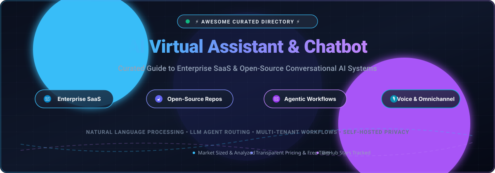

# 🤖 Awesome AI Virtual Assistant & Chatbot

<div align="center">



<p align="center">
  <strong>Curated Directory of Enterprise SaaS Platforms &amp; Open-Source Conversational AI Systems</strong>
</p>

<p align="center">
  <a href="https://github.com/ishandutta2007/Awesome-Awesome-Awesome"></a><a href="https://discord.gg/jc4xtF58Ve"></a>
  <a href="https://github.com/ishandutta2007/Awesome-AI-Virtual-Assistant-Chatbot/stargazers"></a>
  <a href="https://github.com/ishandutta2007/Awesome-AI-Virtual-Assistant-Chatbot/network/members"></a>
  <a href="LICENSE"></a>
  <a href="https://github.com/ishandutta2007/Awesome-Awesome-Awesome"></a>
  <a href="https://github.com/ishandutta2007/Awesome-AI-Virtual-Assistant-Chatbot/pulls"></a>
  <a href="https://github.com/ishandutta2007"></a>
</p>

<p align="center">
  <em>Explore top enterprise platforms, self-hosted LLM frameworks, agentic flow builders, omnichannel routers, and real-time voice assistants.</em>
</p>

</div>

---

## 📑 Table of Contents

- [🌐 Sector Overview & Market Dynamics](#-sector-overview--market-dynamics)
- [🏢 SaaS & Hosted Platforms](#-saas--hosted-platforms)
  - [📊 SaaS Pricing & Valuation Overview](#-saas-pricing--valuation-overview)
  - [🔍 SaaS Platform Deep Dive](#-saas-platform-deep-dive)
- [🔓 Open-Source GitHub Projects](#-open-source-github-projects)
  - [⭐ Open-Source Ranking by Stars](#-open-source-ranking-by-stars)
  - [🛠️ Open-Source Framework Profiles](#️-open-source-framework-profiles)
- [⚖️ Architectural Decision Matrix](#️-architectural-decision-matrix)
- [🤝 How to Contribute](#-how-to-contribute)
- [💖 Support](#-support)
- [⭐ Star History](#-star-history)
- [📜 Disclaimer & Compliance](#-disclaimer--compliance)

---

## 🌐 Sector Overview & Market Dynamics

The global conversational AI and AI virtual assistant market is estimated at **$14.8B – $17.1B in 2025** and projected to exceed **$37.5B – $49.8B by 2030–2031** (growing at an aggressive CAGR of ~20% to nearly 30%), driven by multimodal generative AI, autonomous agentic workflows, and pervasive enterprise contact center automation.

The sector exhibits **moderate fragmentation with strong niche consolidation**: while foundational LLM infrastructure and enterprise helpdesk ecosystems (e.g., IBM, Zendesk, Salesforce) command major enterprise footprints, no single player maintains a "winner-take-all" monopoly due to diverse deployment requirements across regulatory compliance, self-hosted data sovereignty, omnichannel orchestration, and specialized voice telephony.

---

## 🏢 SaaS & Hosted Platforms

### 📊 SaaS Pricing & Valuation Overview

The table below lists leading commercial virtual assistant and conversational AI platforms sorted descending by company scale (Valuation / Market Capitalization / Estimated Annual Revenue).

| 🏢 Product | 💰 Starting Tier Price | 🎁 Free Tier / Trial Limit | 📈 Scale (Valuation / Revenue) | 🎯 Best For |
| :--- | :--- | :--- | :--- | :--- |
| **IBM watsonx Assistant** | **$140/month** (Plus plan, incl. 1,000 MAUs; $14/100 MAUs overage; $0.60/1k RUs; Voice $9/100 MAUs) | **Free Forever** (Lite plan: 1,000 active users/month, up to 5 skills, 30 days inactivity retention) | **~$200B+ Market Cap** (~$62B ARR parent) | Enterprise governance, RAG, hybrid-cloud security & regulated industries |
| **Zendesk AI** | **$19/agent/month** (Support Team, annual) or **$55/agent/month** (Suite Team) + $1.50–$2.00/automated resolution | **14-day free trial** (Full Suite Enterprise access, up to 5 trial agent seats, no credit card required) | **~$10.2B Valuation** (~$1.7B ARR) | Native helpdesk ticketing integration & high-volume customer service desks |
| **Freshworks Freddy AI** | **$19/agent/month** (Freshchat Growth) + Freddy AI Agent at **$49 per 100 sessions**; Copilot **$29/agent/month** | **Free Forever** (Freshchat Free plan for up to 10 agents; plus 14-day Enterprise trial with 50 free Freddy AI sessions) | **~$4.5B Market Cap** (~$700M ARR) | SMB-to-midmarket service teams wanting modular per-session AI capacity |
| **Intercom Fin** | **$0.99/outcome** (Fin AI resolution fee) + workspace seat starting at **$39/seat/month** (Essential) or **$85/seat/month** (Advanced) | **14-day free trial** (Includes full platform features and up to 10 free Fin AI resolutions) | **~$1.3B Valuation** (~$300M ARR) | High-growth SaaS teams seeking outcome-based AI deflection |
| **Drift** | **$9.99/month** (Standard plan: 50 chat queries/month; Pro plan at **$29.99/month** for unlimited queries) | **Free Forever** (Free plan: 10 queries/month, 1 live chat seat, basic bot playbooks) | **~$1.0B Valuation** (Acquired by Vista / Salesloft) | B2B pipeline generation, conversational marketing & website conversion |
| **Kore.ai** | **$100 one-time reload** (Pay-as-you-go metering after promotional allowance, consumption-based) | **Free Forever** (5,000 free lifetime sessions, up to 5 virtual assistants per account) | **~$804M–$1.2B Valuation** (~$145M+ ARR) | Large enterprise contact centers requiring custom dialog tasks & telephony |
| **Yellow.ai** | **Custom quoted** (Starts with pay-as-you-go / premium enterprise contract via sales) | **Free Forever** (Freemium plan: 5,000 bot conversations/month, 500 tickets/month, unlimited agent seats, 2 channels) | **~$550M Valuation** (~$35M–$80M ARR) | Global organizations seeking bilingual/multilingual omni-channel automation |
| **Ada** | **$33,000/year** (Starting entry package on AWS Marketplace for 60,000 annual conversations) | **No Free Tier / No Self-Serve Trial** (Enterprise sandbox provided only via guided sales demonstration) | **~$430M Valuation** (~$70M ARR, merging with Dialpad) | Autonomous conversational customer experience across voice and messaging |
| **LivePerson** | **$599/month** (Standard entry commitment based on DAR Engagement Credits + SMS/WhatsApp channel fees + 15% handling fee) | **30-day free trial** (Available on select partner cloud marketplaces; otherwise proof-of-concept via sales) | **~$150M Market Cap** (~$320M Annual Revenue) | High-throughput enterprise messaging with complex human-agent orchestration |
| **Zoho SalesIQ (Zia)** | **$7/user/month** (Basic plan, billed annually) or **$14/user/month** (Professional plan unlocking advanced Zia AI features) | **Free Forever** (Free plan for 3 operators, 100 chat sessions/month; plus 15-day Enterprise trial with full Zia AI bot access) | **Private bootstrapped** (~$1.4B+ Zoho Corp Revenue) | Zoho CRM / Desk ecosystem users seeking unified live chat and agentic workflows |

---

### 🔍 SaaS Platform Deep Dive

- **IBM watsonx Assistant** 🛡️
  Enterprise conversational AI platform featuring generative AI capabilities, Conversational Search RAG, and native enterprise governance.
  - **Starting Price**: Lite is free; Plus begins at $140/month.
  - **Free Tier**: Perpetual Lite tier with 1,000 MAUs.
  - **Best For**: Highly regulated industries (banking, telecom, healthcare) requiring strict data governance and hybrid-cloud deployments.

- **Zendesk AI** 🎧
  Deeply integrated AI agent inside the Zendesk customer experience ecosystem, with outcome-based pricing.
  - **Starting Price**: $19/agent/month (Support Team) + automated resolution overages.
  - **Free Tier**: 14-day fully featured Enterprise trial.
  - **Best For**: Support teams running Zendesk who want seamless escalation between AI deflection and human ticketing.

- **Freshworks Freddy AI** ⚡
  Modular AI assistant for customer service, IT service management (ITSM), and sales automation.
  - **Starting Price**: $19/agent/month (Growth) + Freddy AI Agent at $49 per 100 sessions.
  - **Free Tier**: Free plan for up to 10 agents + 14-day Enterprise trial with 50 AI sessions.
  - **Best For**: Fast-growing businesses seeking predictable per-session pricing without massive upfront enterprise lock-in.

- **Intercom Fin** 🚀
  Groundbreaking generative AI customer service agent built on top of Claude/GPT-4o that autonomously resolves support tickets.
  - **Starting Price**: $0.99 per successful resolution + seat fee ($39/seat/month).
  - **Free Tier**: 14-day free trial with 10 free resolution outcomes.
  - **Best For**: Tech startups and modern scale-ups seeking automated resolutions charged solely on success.

- **Drift** 🎯
  Conversational marketing and AI bot platform engineered to qualify leads, book meetings, and accelerate B2B pipeline.
  - **Starting Price**: $9.99/month (Standard tier for 50 queries).
  - **Free Tier**: Free plan with 10 queries/month.
  - **Best For**: Revenue marketing and sales development teams driving real-time inbound pipeline.

- **Kore.ai Experience Optimization (XO) Platform** 🏆
  Enterprise-grade virtual assistant platform supporting complex multi-intent dialogues, IVR telephony integrations, and enterprise search.
  - **Starting Price**: Pay-as-you-go reload starting at $100 after 5,000 complimentary sessions.
  - **Free Tier**: 5,000 free sessions across up to 5 virtual assistants.
  - **Best For**: Tier-1 enterprise contact centers requiring omnichannel voice + digital conversational bots.

- **Yellow.ai** 🌐
  Dynamic automation platform powered by multi-LLM architecture supporting 135+ languages and cross-channel messaging.
  - **Starting Price**: Custom quotes based on interaction volume.
  - **Free Tier**: Freemium plan with 5,000 bot conversations/month and 500 tickets/month.
  - **Best For**: Multilingual enterprise support across WhatsApp, web, and social messaging channels.

- **Ada** 🤝
  No-code agentic customer service platform designed to orchestrate complex reasoning and resolve customer issues end-to-end.
  - **Starting Price**: $33,000/year for 60,000 annual interactions.
  - **Free Tier**: No self-serve free tier; sandbox environments via sales demo.
  - **Best For**: Enterprises replacing tier-1 support across chat, email, and voice with autonomous agentic resolution.

- **LivePerson Conversational Cloud** 💬
  Enterprise conversational cloud with asynchronous messaging, proactive notifications, and bot-to-human routing.
  - **Starting Price**: Custom engagement credit tiers starting ~$599/month.
  - **Free Tier**: 30-day trial via cloud marketplace partners.
  - **Best For**: Massive consumer enterprises handling millions of monthly messaging touchpoints across Apple Messages for Business, WhatsApp, and SMS.

- **Zoho SalesIQ (Zia Agents)** 💼
  Customer engagement and live chat suite augmented with Zia conversational AI bots.
  - **Starting Price**: $7/user/month (Basic) or $14/user/month (Professional).
  - **Free Tier**: Free plan for 3 operators and 100 chats/month; 15-day Enterprise trial with full Zia bot builder.
  - **Best For**: Organizations powered by Zoho One, Zoho CRM, and Zoho Desk.

---

## 🔓 Open-Source GitHub Projects

### ⭐ Open-Source Ranking by Stars

The following table lists premier open-source virtual assistants, visual flow builders, multi-agent frameworks, and voice agent runtimes, ranked descending by GitHub star count:

| 🏆 Project | ⭐ GitHub Stars | 💻 Primary Stack | 📜 License | 🎯 Key Architecture / Specialization |
| :--- | :--- | :--- | :--- | :--- |
| [**Dify**](https://github.com/langgenius/dify) | [](https://github.com/langgenius/dify/stargazers) | TypeScript, Python | Apache 2.0 | Complete LLM application development platform, visual agent workflow builder, RAG engine & chatbot orchestration |
| [**Open WebUI**](https://github.com/open-webui/open-webui) | [](https://github.com/open-webui/open-webui/stargazers) | Python, Svelte, TypeScript | Open Source | Extensible, self-hosted AI interface for Ollama, OpenAI-compatible APIs, multi-user chat management & RAG |
| [**Langflow**](https://github.com/langflow-ai/langflow) | [](https://github.com/langflow-ai/langflow/stargazers) | Python, React | MIT | Visual IDE for building multi-agent AI assistants, RAG pipelines, and conversational components |
| [**Flowise**](https://github.com/FlowiseAI/Flowise) | [](https://github.com/FlowiseAI/Flowise/stargazers) | TypeScript, Node.js | Apache 2.0 | Drag & drop UI to build customized LLM flows, autonomous agents, and embeddable customer service chat widgets |
| [**Chatwoot**](https://github.com/chatwoot/chatwoot) | [](https://github.com/chatwoot/chatwoot/stargazers) | Ruby on Rails, Vue.js | AGPL 3.0 | Open-source customer engagement suite with native bot webhooks, agent handoff, and omnichannel live chat |
| [**Haystack**](https://github.com/deepset-ai/haystack) | [](https://github.com/deepset-ai/haystack/stargazers) | Python | Apache 2.0 | Production-ready LLM orchestration framework for building conversational search, RAG pipelines, and enterprise assistants |
| [**Rasa**](https://github.com/RasaHQ/rasa) | [](https://github.com/RasaHQ/rasa/stargazers) | Python | Apache 2.0 | Industry-standard conversational AI framework for building intent-driven text and voice assistants with deterministic dialogue policies |
| [**elizaOS (Eliza)**](https://github.com/elizaOS/eliza) | [](https://github.com/elizaOS/eliza/stargazers) | TypeScript | MIT | Multi-agent autonomous framework with native connectors for Discord, Twitter/X, Telegram, and persistent agent personality memory |
| [**LiveKit Agents**](https://github.com/livekit/agents) | [](https://github.com/livekit/agents/stargazers) | Python | Apache 2.0 | Real-time multimodal voice and video AI agent runtime with ultra-low latency WebRTC streaming and turn-detection |
| [**Botpress**](https://github.com/botpress/botpress) | [](https://github.com/botpress/botpress/stargazers) | TypeScript, Node.js | AGPL 3.0 / BSL | Developer-friendly visual chatbot builder with modular NLU, workflow canvas, and multi-channel connectors |
| [**Cel.ai**](https://github.com/cel-ai/celai) | [](https://github.com/cel-ai/celai/stargazers) | Python | MIT | Purpose-built omnichannel virtual assistant framework with multi-assistant logic routers, LangChain integration, and voice/chat connectors |

---

### 🛠️ Open-Source Framework Profiles

- [**Dify**](https://github.com/langgenius/dify) 🌟
  **The all-in-one open-source LLM application platform.** Features a visual orchestration canvas for prompt engineering, agentic workflows, contextual RAG, and an out-of-the-box web chat client that can be deployed via Docker in minutes.

- [**Open WebUI**](https://github.com/open-webui/open-webui) 🖥️
  **The ultimate self-hosted conversational interface.** Delivers a ChatGPT-like web UI that integrates locally with Ollama or remote LLM endpoints, featuring multi-model conversations, document RAG, web browsing tools, and granular user role management.

- [**Langflow**](https://github.com/langflow-ai/langflow) 🎨
  **Visual prototyping framework for AI assistants.** Enables developers to visually construct multi-agent networks, complex vector database pipelines, and contextual conversational bots with instantaneous component-level debugging.

- [**Flowise**](https://github.com/FlowiseAI/Flowise) 🔌
  **Drag-and-drop conversational agent framework.** Built for rapid deployment of customer-facing chatbot widgets, API endpoints, and memory-backed conversational agents powered by LangChain and LlamaIndex.

- [**Chatwoot**](https://github.com/chatwoot/chatwoot) 📬
  **Self-hosted customer engagement & omnichannel inbox.** Serves as the conversational interface and live-agent escalation layer for AI bots across WhatsApp, Twitter, Facebook, Email, and Web chat.

- [**Haystack**](https://github.com/deepset-ai/haystack) 🔍
  **Enterprise conversational search & RAG framework.** Ideal for building conversational knowledge assistants that reliably answer complex questions across vast document repositories with citations.

- [**Rasa**](https://github.com/RasaHQ/rasa) 🏛️
  **The enterprise benchmark for on-premise NLU.** Offers full control over machine learning pipelines, intent classification, entity extraction, and state machine dialogue management—favored by banks and privacy-sensitive enterprises.

- [**elizaOS (Eliza)**](https://github.com/elizaOS/eliza) 🧠
  **Autonomous multi-agent system runtime.** Tailored for developing autonomous virtual personalities and assistants that interact continuously across Discord, Telegram, and social networks with persistent character memory.

- [**LiveKit Agents**](https://github.com/livekit/agents) 🎙️
  **Ultra-low latency real-time voice agent framework.** Powers voice-first virtual assistants capable of conversational interruptions, natural pauses, and sub-second voice-to-voice streaming via WebRTC.

- [**Botpress**](https://github.com/botpress/botpress) 🗺️
  **Visual conversation designer.** Combines a flowchart-based conversation builder with modular hooks and multi-channel connectors for structured dialogue and workflow automation.

- [**Cel.ai**](https://github.com/cel-ai/celai) 🔀
  **Lightweight omnichannel assistant router.** Designed specifically to route inbound messages from WhatsApp, Telegram, or Vapi.ai across specialized sub-assistants while maintaining concise LLM context windows.

---

## ⚖️ Architectural Decision Matrix

```
                        ┌────────────────────────────────────────────────────────┐
                        │ What is your primary deployment & control requirement? │
                        └───────────────────────────┬────────────────────────────┘
                                                    │
                 ┌──────────────────────────────────┴──────────────────────────────────┐
                 ▼                                                                     ▼
      [ Enterprise Managed SaaS ]                                            [ Self-Hosted Open-Source ]
                 │                                                                     │
    ┌────────────┴────────────┐                                           ┌────────────┴────────────┐
    ▼                         ▼                                           ▼                         ▼
[ Outcome Deflection ]   [ Full Contact Center ]                     [ Visual Agent Canvas ]   [ Real-Time Voice / NLU ]
  • Intercom Fin           • Kore.ai XO Platform                       • Dify                    • LiveKit Agents (Voice)
  • Zendesk AI             • IBM watsonx Assistant                     • Langflow                • Rasa (On-prem NLU)
  • Freshworks Freddy      • Yellow.ai                                 • Flowise                 • Cel.ai (Omnichannel)
```

- **Choose Enterprise SaaS** if your priority is zero-maintenance SLA, turnkey contact center telephony, native ticketing sync, and outcome-based pricing models.
- **Choose Open-Source Frameworks** if you require full data sovereignty (GDPR/HIPAA compliance), zero vendor lock-in, on-premise local model inference (via Ollama/vLLM), or custom voice agent streaming.

---

## 🤝 How to Contribute

Contributions are welcome! Please help expand and refine this directory:

1. 🍴 Fork the repository.
2. 🌿 Create a feature branch: `git checkout -b feature/add-new-assistant`.
3. 📝 Update `README.md` maintaining the existing structure:
   - For SaaS products: include verified starting tier price, exact free tier / trial limit, scale (valuation/revenue), and core specialization.
   - For open-source projects: ensure the GitHub repository link and star badge link (`style=social&color=white`) point to the stargazers page.
4. 🚀 Submit a Pull Request with a clear description of the project and why it belongs in the list.

---

## 💖 Support

Thank you so much for exploring this project! If you find this curated list helpful in your conversational AI development, research, or product evaluations, please consider supporting the project:

- ⭐ **Star** this repository to show your appreciation!
- 🍴 **Fork** and contribute new platforms or open-source tools.
- 📢 **Share** it with fellow AI engineers, builders, and community channels!
- ☕ **Buy me a coffee**: Support ongoing maintenance and curated updates directly via my [GitHub Sponsors Dashboard](https://github.com/sponsors/ishandutta2007).

---

## ⭐ Star History

[](https://www.star-history.com/#ishandutta2007/Awesome-AI-Virtual-Assistant-Chatbot&type=date&legend=top-left)

---

## 📜 Disclaimer & Compliance

- This repository is a community-curated directory compiled for educational and architectural evaluation purposes.
- Mentions of commercial SaaS platforms and open-source projects do not imply official affiliation or commercial endorsement.
- Organizations deploying conversational AI virtual assistants must comply with regional privacy regulations (GDPR, CCPA, HIPAA) and implement strict safeguards against prompt injection, hallucination, and sensitive data leakage.

---

<div align="center">
  <sub>⭐ Star this repository if you find it helpful for your conversational AI journey! 🌟</sub>
</div>
